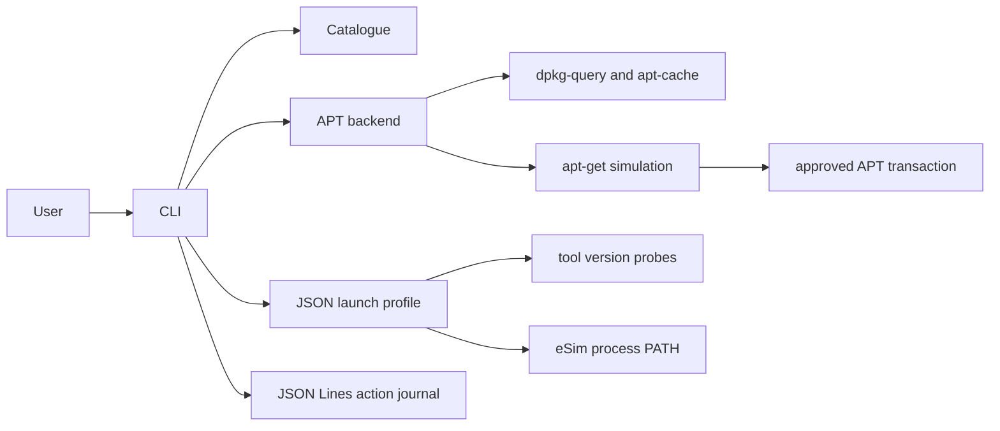

# Design · eSim Tool Manager

## Scope

The manager covers five parts of the benchmark on Ubuntu. It installs catalogue tools and their dependencies, verifies exact package versions, checks and applies updates, builds eSim's launch environment, and provides diagnostics and action logs. The core tool selection is ngspice and KiCad. GHDL and Verilator are opt-in because they carry different dependencies and serve separate workflows.

The package backend targets Ubuntu APT. A Windows or macOS port needs a backend with equivalent candidate, version, transaction-preview, and verification behavior. eSim installation and release-specific co-simulation wiring are independent from standalone tool management.

## Components and responsibilities

| Component | Responsibility |
| --- | --- |
| [Catalogue](esim_tools/catalog.py) | Maps tool IDs to Ubuntu packages, roles, and executable probe commands. |
| [APT backend](esim_tools/apt.py) | Reads dpkg and APT policy, compares Debian versions, simulates transactions, and runs approved package operations. |
| [Workspace](esim_tools/workspace.py) | Validates and atomically replaces the JSON launch profile, provides an interprocess lock, and appends structured audit events. |
| [CLI](esim_tools/cli.py) | Selects tools, validates exact pins and compatibility floors, presents diagnostics and proposed changes, and coordinates package and launch operations. |
| [Tests](tests/) | Exercises the parsing and transaction contracts and validates real package operations in a disposable Ubuntu environment. |

## Installation and upgrade transaction

1. **Inspect** each selected tool. `dpkg-query` supplies the installation state, installed version, and hold status. `apt-cache policy` supplies the current candidate. Packaged and executable versions are kept as separate observations because packaging revisions and PATH resolution can differ.
2. **Resolve** an exact target for each changed tool. The default is the candidate. An explicit pin accepts a Debian package version and must refer to a selected tool. `dpkg --compare-versions` handles epochs, revisions, and prereleases. Upgrades require a configured package. Holds, downgrades, and partial installations call for user review.
3. **Preview** the specific APT install transaction with removals disabled. The manager shows requested and transitive changes, rejects removals and downgrades, and checks that APT plans the requested versions. A pending configuration operation also stops the plan.
4. **Apply** the reviewed change after an interactive confirmation or `--yes`. The manager runs the simulation again, compares the plans, and calls APT with explicit package targets and `--no-remove`. A per-user lock serializes manager mutations. APT and dpkg provide their own package locks.
5. **Verify** the resulting installed versions and log the outcome. An APT failure can leave a partial package state. The manager reports it and leaves recovery to APT and dpkg. The repeated simulation reduces the chance of an unexpected transaction, but another process can still change system state between the simulation and APT acquiring its lock.

APT obtains packages from the system's configured sources. The program does not add repositories, change repository trust, or build software from source. It uses a fixed system PATH and C locale for APT commands. [Ubuntu apt-get manual](https://manpages.ubuntu.com/manpages/noble/man8/apt-get.8.html)

## Diagnostics, launch configuration, and logging

`doctor` combines a read-only APT dependency check with runtime executable probes. It reports absent or partially configured packages, missing binaries, unexpected PATH resolution, and version-floor failures. `--esim` adds a check for the launcher. It offers concrete next commands without applying repairs.

The launch profile stores an eSim executable path and an ordered list of additional executable directories. Profile writes are atomic. The manager builds a child environment for probes and for the eSim launch. Arguments are passed as an argument vector, so paths with spaces stay intact. Only the APT commands need elevation.

The audit log keeps UTC timestamps, operations, outcomes, requested versions, and verified installed versions. Package-manager output stays on the console, while errors write a short summary to the journal. Launcher arguments are omitted from log records.

## Verification strategy

- Unit tests cover Debian version ordering, exact target parsing, held and missing packages, unexpected APT changes, stale previews, version floors, profile round trips, and the mutation lock.
- The Ubuntu integration test uses signed packages. It temporarily pins the exact GHDL companion package within the disposable container to install the older Ubuntu release version before observing and applying the update.
- The test checks KiCad's APT plan without altering the package database, uses a small launcher fixture to verify the child PATH and argument forwarding, and runs an ngspice resistor-divider simulation. Interactive KiCad and eSim GUI behavior require a desktop test.

### Observed results

| Check | Ubuntu 24.04.5 LTS amd64 result |
| --- | --- |
| Missing-tool diagnosis | `doctor ngspice` returned 1 before installation. |
| KiCad preview | APT proposed KiCad 7.0.11 and its dependency transaction. KiCad remained absent from dpkg. |
| Exact-version installation | APT installed ngspice `42+ds-3build1` and GHDL `4.1.0+dfsg-0ubuntu2`. Both executable version probes succeeded. |
| Update discovery and application | The manager detected `4.1.0+dfsg-0ubuntu2.1`, upgraded GHDL and its matching companion package, and verified the new version. Repeating the upgrade produced an empty plan. |
| Launch and audit | A fixture discovered through the configured PATH received an argument with spaces intact. The action journal contained successful install, upgrade, and launch entries. |
| Analog behavior | ngspice measured 5.000 V at the midpoint of a 10 V equal-resistor divider. |

All 15 unit tests passed. The live run used the Ubuntu 24.04 amd64 image pinned in [the integration script](tests/live-ubuntu.sh).
